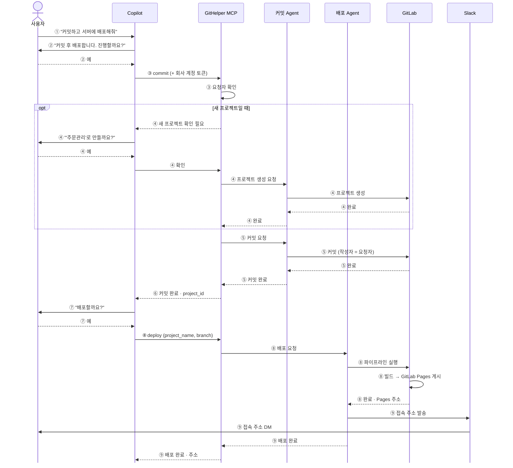

# 시퀀스: 커밋 + 배포 한 번에 (GitLab Pages)

- 기준일: 2026-10-23
- 보는 방법: md 미리보기에서 바로 보거나, 아래 원본을 sequencediagram.org에 붙여 넣습니다.
- 화살표: 실선은 요청, 점선은 응답. 화살표를 받은 쪽이 다음 화살표를 보냅니다.
- 주황색(sequencediagram.org 원본): 사용자가 말하거나 답하는 순간
- 구현 및 사용 방법: [README.md](README.md)

## 다이어그램 (md에서 바로 보기)

GitLab, GitHub, VS Code 미리보기에서 그림으로 표시됩니다. 보는 쪽의 밝은 테마와 어두운 테마를 그대로 따릅니다.

## 참여자

| 참여자 | 실체 | 실행 위치 |
|---|---|---|
| 사용자 | 개발자 · 비개발자 | — |
| Copilot | VS Code Copilot Agent 모드 | 사용자 PC |
| GitHelper MCP | Copilot이 호출하는 단일 입구. 요청자 확인 후 각 Agent에 일을 나눔 | Azure (앱 1개) |
| 커밋 / 배포 Agent | GitHelper MCP 서버 안의 담당 | Azure (같은 앱) |
| GitLab | 코드 보관 · 파이프라인 · GitLab Pages (REST API로 호출) | 사내 GitLab |
| Slack | 결과 DM | Slack |

## 참고

- **요청자 식별:** VS Code가 회사 계정(Entra ID) 토큰을 GitHelper MCP 호출마다 붙여 보냅니다.
- **④ 질문 경로:** GitHelper MCP는 사용자에게 직접 말할 수 없습니다. 그래서 응답을 Copilot에 돌려주고, Copilot이 사용자에게 묻습니다.
- **GitLab Pages 제약 (확인 필요):** GitLab Pages는 정적 사이트(HTML · JS · CSS)만 올릴 수 있어서, 서버 코드나 DB가 필요한 앱은 이 방식으로 배포할 수 없습니다. 

## 스펙 단계

### 1차 스펙 (현재)

- 정적 사이트만 지원 (HTML · JS · CSS, npm 빌드)
- Copilot에게 말로 요청 → 커밋 → 배포 → 사이트 주소까지 한 번에
- 사이트 이름 + 폴더만 알려주면 됨 (새 사이트일 경우, 자동 생성)
- 배포 성공/실패 유무 **지정한 Slack 채널**로 알림
- 배포 실패 시 Copilot이 수정 제안 → 승인 → 재배포 (최대 5회)
- 사이트 중지 가능 (코드는 보존)
- (진행중) MS 로그인 (이름·이메일 취득 및 권한체크)

### 2차 스펙 (예정)

- Slack 알림을 채널이 아닌 **요청자 본인 DM**으로 발송 (채널 입력 불필요)
- 새 경로를 생성할지, 기존 경로에 덮어씌울지 자동 처리 방법 확인
- 